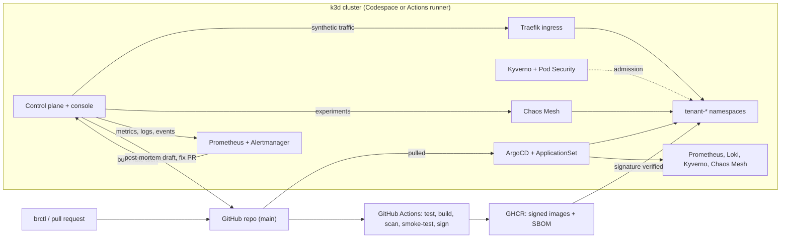

# BlastRadius

A multi-tenant Kubernetes platform, managed entirely through Git, that attacks itself every night with chaos experiments, proves that one tenant cannot hurt another, and drafts its own post-incident reviews.

## What it is

- **GitOps platform.** Terraform builds a k3d cluster and bootstraps ArgoCD; every other change is a pull request.
- **Isolated tenants.** One file per tenant becomes a namespace with quotas, network rules, RBAC, Pod Security and Kyverno admission.
- **Nightly chaos.** A scheduled workflow rebuilds the platform from nothing, runs a chaos campaign and scores how many bystander tenants moved.
- **Incident Scribe.** Burn-rate alerts turn into draft post-mortems full of evidence, and guard-railed fix PRs that wait for a human.

It costs $0: clusters run in GitHub Codespaces and GitHub Actions.

## How it fits together



A chaos run measures a baseline, injects one fault into one tenant, watches every tenant and scores the run by the number of bystander tenants that moved. Zero is the goal.

## Scorecard

<!-- scorecard:start -->
12 chaos runs: 6 scored, 3 invalid, 3 failed. Last run 2026-11-12 17:08 UTC.

| Experiment | Runs | Runs with impacted bystanders | Most impacted | Detect (median) | Recover (median) |
|---|---|---|---|---|---|
| `cpu-stress` | 9 | 0 | 0 | 5 s | 40 s |
| `pod-kill` | 3 | 0 | – | 50 s | 5 s |
<!-- scorecard:end -->

## Game days

Three failures staged on purpose, each with a write-up and a merged prevention.

| | Staged failure | Measured | Prevention |
|---|---|---|---|
| [1](incidents/2026-11-12-game-day-1-noisy-neighbour.md) | A tenant with no CPU limit and no quota, under CPU stress | A neighbour's p95 rose from 5 ms to between 17 and 61 ms; with limits, none moved | CI and admission refuse a limitless tier |
| [2](incidents/2026-11-12-game-day-2-bad-release.md) | A build that passes its probes and fails real requests | Fast-burn alert 85 s after the rollout; recovered 6 min after the revert | Smoke test before signing; readiness that prices a quote |
| [3](incidents/2026-11-12-game-day-3-node-loss.md) | An agent node stopped | Every tenant down for 360 s; about 45 s after the fix | Two Traefik replicas on different nodes |

## Performance

acme's p95 fell from 539 ms to 6 ms at 200 requests per second after raising the small tier's CPU limit from 200m to 400m. Method, data and limits are in [docs/performance.md](docs/performance.md).

## Quickstart

[](https://codespaces.new/erdilatifi/BlastRadius)

```bash
just doctor
just up codespace
export KUBECONFIG=$PWD/terraform/cluster/kubeconfig
kubectl -n blastradius-system port-forward svc/controlplane 8080:8080 &
kubectl -n kube-system port-forward svc/traefik 8083:80 &
cargo run -q -p brctl -- status
cargo run -q -p brctl -- chaos run cpu-stress acme
```

`brctl` talks to the control plane on port 8080. The console is at `http://blastradius.localhost:8083`, user `admin`, password in `terraform/cluster/console-password`. `just down` removes the cluster. Stop the Codespace when you are done.

## Develop

`just check` runs the Rust, web and Python tests. Pinned versions live in [versions.env](versions.env); code rules in [CONTRIBUTING.md](CONTRIBUTING.md).

## Read more

- [Decisions](docs/adr): nine ADRs, one per choice that had a real alternative.
- [Incidents](incidents): the game day write-ups.
- [Runbooks](runbooks): one per alert.
- [Performance](docs/performance.md) and [environments](docs/environments.md).
- [Run ledger](data/runs.jsonl): every chaos run, written by the nightly workflow.
