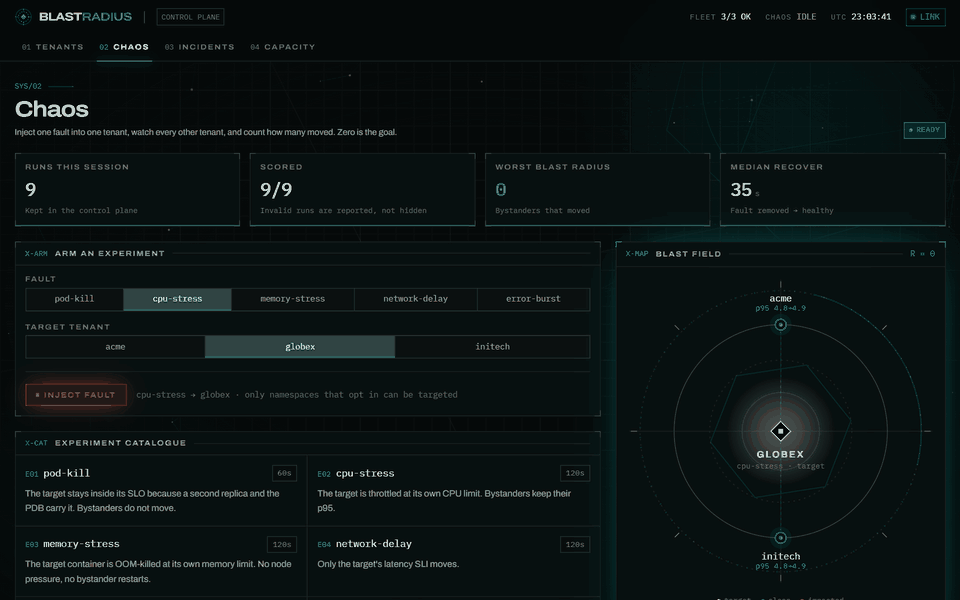
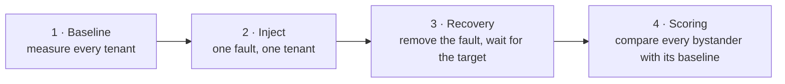
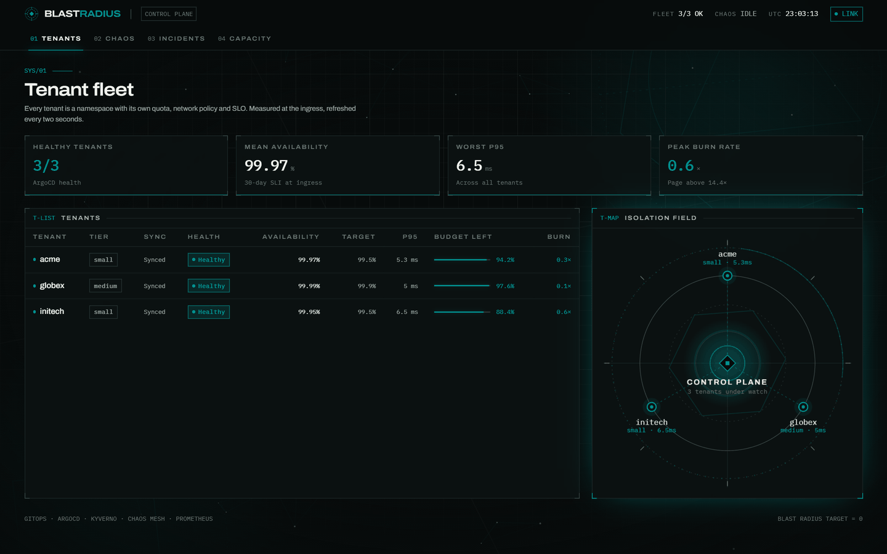
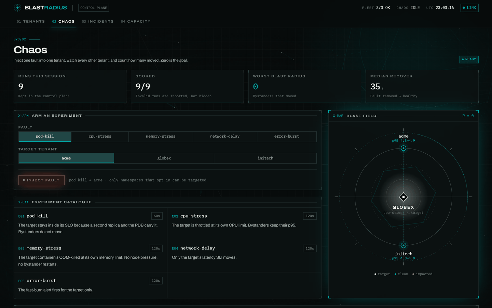
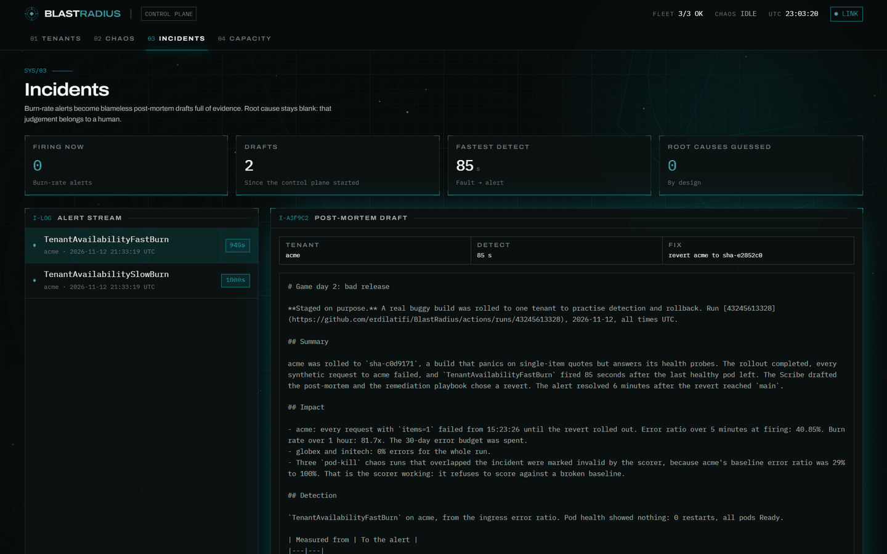
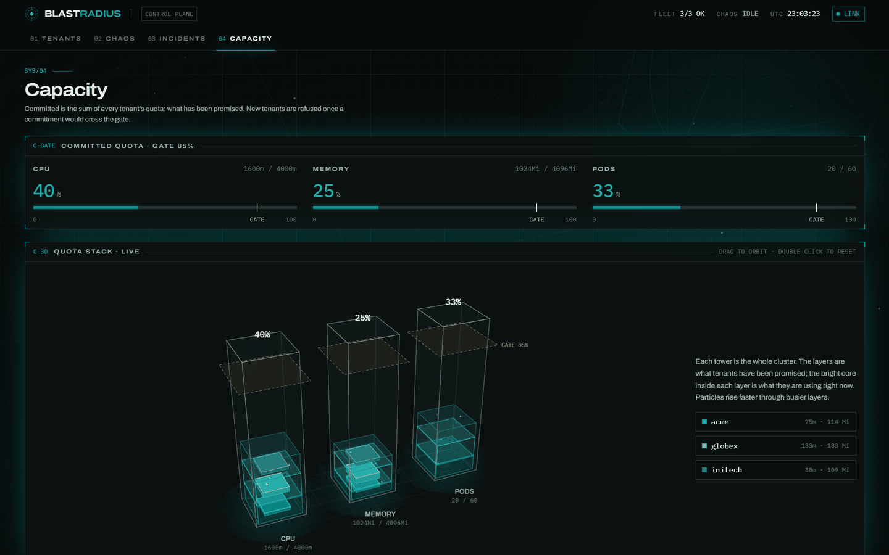
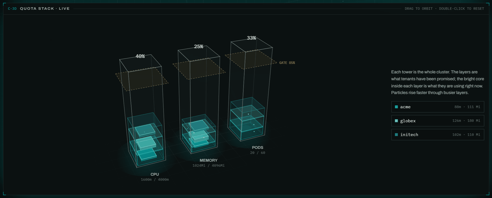
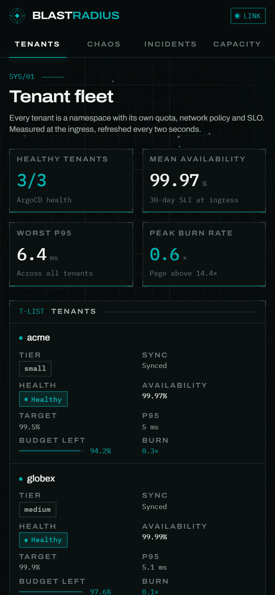
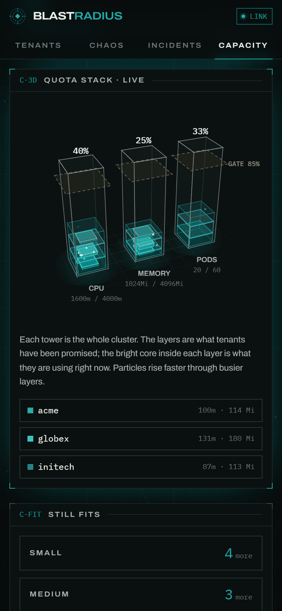
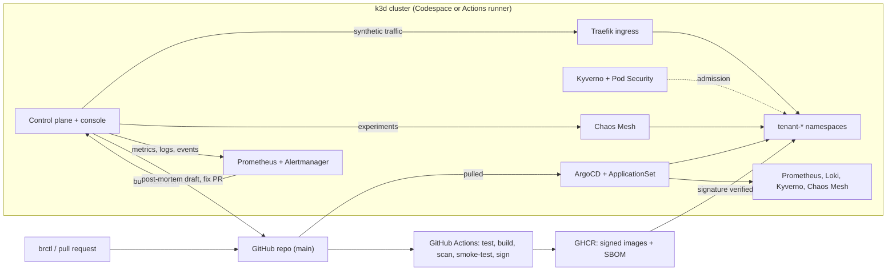

# BlastRadius

**Proof that one tenant cannot hurt another.** BlastRadius injects a real fault into one tenant of a multi-tenant Kubernetes cluster. It then watches every other tenant and counts how many of them moved. That count is the blast radius, and the goal is zero.



*A `cpu-stress` run against `globex`. The fault throttles globex at its own CPU limit. acme and initech keep their p95 (4.8 → 4.9 ms), so the run scores R = 0.*

## Who it is for

- **Platform teams that host several teams or customers on one cluster.** Quotas, limits, NetworkPolicies and PodDisruptionBudgets look right on paper. BlastRadius checks that they still hold under a real fault.
- **Auditors and security reviewers** who want evidence of tenant isolation, not a diagram. Every run is recorded with its baseline, the fault, and the reason each tenant was or was not affected.
- **CI pipelines.** `brctl chaos run` follows a run to its score, prints the reasons for every tenant, and exits non-zero if the run fails. A nightly workflow rebuilds the platform from nothing, runs the whole campaign and updates the scorecard below.

## What it does

| | |
|---|---|
| **Chaos runs with a score** | Kills pods, stresses CPU or memory, delays the network or raises errors in one tenant, using Chaos Mesh. Then it scores every bystander against its own baseline. |
| **Works on your cluster** | The [`isolation-checker`](charts/isolation-checker) Helm chart installs only the control plane. You tell it which namespaces are tenants and give it three PromQL queries. |
| **A console** | A live view of tenants, runs, incidents and capacity, including a 3D view of how each tenant's quota stacks up against the cluster. |
| **A full demo platform** | Terraform, a k3d cluster and ArgoCD. Tenants are one file each, admitted by Kyverno and Pod Security, with SLOs, burn-rate alerts and runbooks. It costs $0: it runs in GitHub Codespaces and GitHub Actions. |
| **Incident Scribe** | A burn-rate alert becomes a draft post-mortem with the evidence attached. A guard-railed fix arrives as a pull request that waits for a human. |

## How a run works



1. **Baseline.** Every tenant is measured for `baselineSeconds` (120 s by default): request rate, error ratio, p95 latency, pod restarts and unready pods.
2. **Inject.** One Chaos Mesh fault is created in the target's namespace and held for the experiment's `injectSeconds`. Only namespaces that opted in can be targeted.
3. **Recovery.** The fault is removed. The control plane waits up to `recoverySeconds` for the target to return to its baseline, and records time to detect and time to recover.
4. **Scoring.** Each bystander is compared with its own baseline. It counts as **impacted** when:
   - its error ratio rose by more than `errorRisePp` (0.5 percentage points), or
   - its p95 grew past both `p95Factor` × baseline (1.5×) and baseline + `p95MarginMs` (10 ms), or
   - its pods restarted or turned unready.

The blast radius is the number of impacted bystanders. A run where some tenant had no traffic, or was already unhealthy in the baseline, is reported as **invalid** instead of scored, because a quiet or broken tenant cannot show harm.

The experiments in the catalog:

| Experiment | Hypothesis |
|---|---|
| `pod-kill` | The target stays inside its SLO because a second replica and the PDB carry it. Bystanders do not move. |
| `cpu-stress` | The target is throttled at its own CPU limit. Bystanders keep their p95. |
| `memory-stress` | The target container is OOM-killed at its own memory limit. No node pressure, no bystander restarts. |
| `network-delay` | Only the target's latency SLI moves. |
| `error-burst` | The fast-burn alert fires for the target only. (Demo workload only.) |

## The console

| Tenants | Chaos |
|---|---|
|  |  |
| Every tenant's sync and health, availability, p95, error budget and burn rate. | Pick a fault and a target, follow the run phase by phase, and see each tenant on the blast field. |

| Incidents | Capacity |
|---|---|
|  |  |
| Draft post-mortems from burn-rate alerts, with timelines, evidence and the fix PR. | Quota against the cluster, the capacity gate, and the CPU and memory each tenant actually uses. |



The capacity stack is drawn in plain canvas, with no 3D library. Each slab is one tenant's quota; the lit core inside it is what the tenant uses now. The dashed plane is the capacity gate. Drag to orbit, hover a slab or a legend entry to highlight it, and double-click to reset.

The console works on phones too:

<p>
  
  &nbsp;
  
</p>

## Try the demo platform

The demo builds a whole platform: a k3d cluster, ArgoCD, Prometheus, Loki, Kyverno, Chaos Mesh, three tenants (`acme`, `globex`, `initech`) and synthetic traffic.

[](https://codespaces.new/erdilatifi/BlastRadius)

A 4-core Codespace is enough. Inside it:

```bash
just doctor
just up codespace
export KUBECONFIG=$PWD/terraform/cluster/kubeconfig
kubectl -n blastradius-system port-forward svc/controlplane 8080:8080 &
kubectl -n kube-system port-forward svc/traefik 8083:80 &
cargo run -q -p brctl -- status
cargo run -q -p brctl -- chaos run cpu-stress acme
```

- **`brctl`** talks to the control plane on port 8080.
- **The console** is at `http://blastradius.localhost:8083`. The user is `admin`, and the password is in `terraform/cluster/console-password`.
- **When you are done,** `just down` removes the cluster. Stop the Codespace as well.

A tenant is one file in [`tenants/`](tenants). `brctl tenant new` validates it, runs the capacity gate and opens a pull request; ArgoCD does the rest.

```yaml
# tenants/acme/values.yaml
name: acme
tier: small          # quota and limits come from the tier
replicas: {min: 2, max: 4}
slo: {availability: 99.5, latencyMs: 300}
chaos: true          # may be targeted by chaos runs
remediation: true    # Incident Scribe may open fix PRs
```

## Install on your own cluster

You need Chaos Mesh and a Prometheus that scrapes kube-state-metrics plus a request metric for each tenant. That metric can come from the application, the ingress controller or a service mesh.

```bash
helm install isolation-checker charts/isolation-checker \
  --namespace isolation-checker --create-namespace \
  --set image.tag=sha-<commit> \
  -f my-values.yaml
```

Tell it what a tenant is and how to measure one:

```yaml
tenants:
  selector: tenant          # every namespace with this label is a tenant
  nameLabel: tenant         # tenant name = the label's value
  optIn: {annotation: chaos-mesh.org/inject, value: enabled}
  slis:                     # PromQL, run once per tenant; $namespace, $tenant and $range are filled in
    requests: 'sum(rate(http_requests_total{namespace="$namespace"}[$range]))'
    errors: 'sum(rate(http_requests_total{namespace="$namespace",code=~"5.."}[$range]))'
    p95Seconds: 'histogram_quantile(0.95, sum by (le) (rate(http_request_duration_seconds_bucket{namespace="$namespace"}[$range])))'
integrations:               # optional
  detectAlert: 'ALERTS{alertstate="firing",namespace="$namespace"}'   # records time to detect
  argocd: {namespace: argocd, appPrefix: team-}                         # sync and health columns
```

Then label and opt in the namespaces, and start a run:

```bash
kubectl label namespace payments-prod tenant=payments
kubectl annotate namespace payments-prod chaos-mesh.org/inject=enabled
kubectl -n isolation-checker port-forward svc/isolation-checker 8080 &
BLASTRADIUS_API=http://localhost:8080 brctl chaos run pod-kill payments
```

The [chart README](charts/isolation-checker/README.md) has ready-made queries for ingress-nginx and Istio, per-tenant overrides, the RBAC the chart needs, and its current limits. Runs are kept in memory, and the API has no login yet, so keep it behind a port-forward or an authenticating ingress.

## `brctl`

| Command | Does |
|---|---|
| `brctl status` | Sync and health of every tenant. Fails unless every tracked tenant is Synced and Healthy. |
| `brctl chaos run <experiment> <tenant>` | Starts one run and follows it to its score. |
| `brctl chaos campaign [experiments...]` | Runs the catalog (all experiments by default) against every tenant in turn. |
| `brctl tenant new <name> --tier small` | Validates a tenant, runs the capacity gate and opens a pull request. |
| `brctl tenant list` | Lists tenants and checks them against the capacity gate. |
| `brctl tenant rm <name>` | Opens a pull request removing a tenant. |
| `brctl ledger export` | Prints this cluster's finished runs as JSON lines. |

## How the demo platform fits together



| Path | What lives there |
|---|---|
| [`crates/controlplane`](crates/controlplane) | The Rust control plane: API, run protocol, scoring and Incident Scribe (axum, kube-rs). |
| [`crates/brctl`](crates/brctl) | The command-line client. |
| [`web`](web) | The console (React, Vite, Tailwind). |
| [`charts`](charts) | `isolation-checker` for your cluster, `blastradius` and `tenant` for the demo. |
| [`platform`](platform) | What ArgoCD installs: monitoring, policies, the chaos catalog. |
| [`terraform`](terraform) | The k3d cluster and the ArgoCD bootstrap. |
| [`tenants`](tenants) | One file per demo tenant. |
| [`reports`](reports) | Python that turns the run ledger into the scorecard and capacity reports. |

## Scorecard

Written by the nightly workflow from the [run ledger](data/runs.jsonl).

<!-- scorecard:start -->
12 chaos runs: 6 scored, 3 invalid, 3 failed. Last run 2026-11-12 17:08 UTC.

| Experiment | Runs | Runs with impacted bystanders | Most impacted | Detect (median) | Recover (median) |
|---|---|---|---|---|---|
| `cpu-stress` | 9 | 0 | 0 | 5 s | 40 s |
| `pod-kill` | 3 | 0 | – | 50 s | 5 s |
<!-- scorecard:end -->

## Game days

Three failures staged on purpose, each with a write-up and a merged prevention.

| | Staged failure | Measured | Prevention |
|---|---|---|---|
| [1](incidents/2026-11-12-game-day-1-noisy-neighbour.md) | A tenant with no CPU limit and no quota, under CPU stress | A neighbour's p95 rose from 5 ms to between 17 and 61 ms; with limits, none moved | CI and admission refuse a limitless tier |
| [2](incidents/2026-11-12-game-day-2-bad-release.md) | A build that passes its probes and fails real requests | Fast-burn alert 85 s after the rollout; recovered 6 min after the revert | Smoke test before signing; readiness that prices a quote |
| [3](incidents/2026-11-12-game-day-3-node-loss.md) | An agent node stopped | Every tenant down for 360 s; about 45 s after the fix | Two Traefik replicas on different nodes |

## Performance

acme's p95 fell from 539 ms to 6 ms at 200 requests per second after raising the small tier's CPU limit from 200m to 400m. Method, data and limits are in [docs/performance.md](docs/performance.md).

## Develop

`just check` runs the Rust, web and Python tests. Pinned versions live in [versions.env](versions.env); code rules are in [CONTRIBUTING.md](CONTRIBUTING.md).

## Read more

- [Decisions](docs/adr): nine ADRs, one per choice that had a real alternative.
- [Incidents](incidents): the game day write-ups.
- [Runbooks](runbooks): one per alert, covering availability burn, latency burn, crash loops and platform capacity.
- [Performance](docs/performance.md) and [environments](docs/environments.md).
- [The isolation-checker chart](charts/isolation-checker/README.md): running BlastRadius on a cluster you already have.
- [Run ledger](data/runs.jsonl): every chaos run, written by the nightly workflow.
