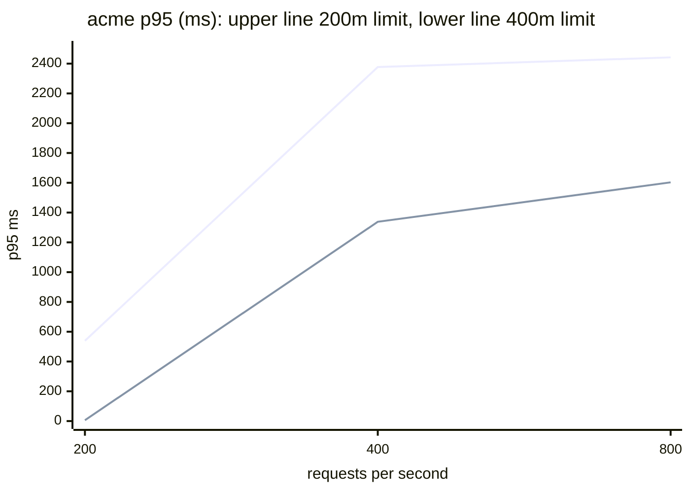
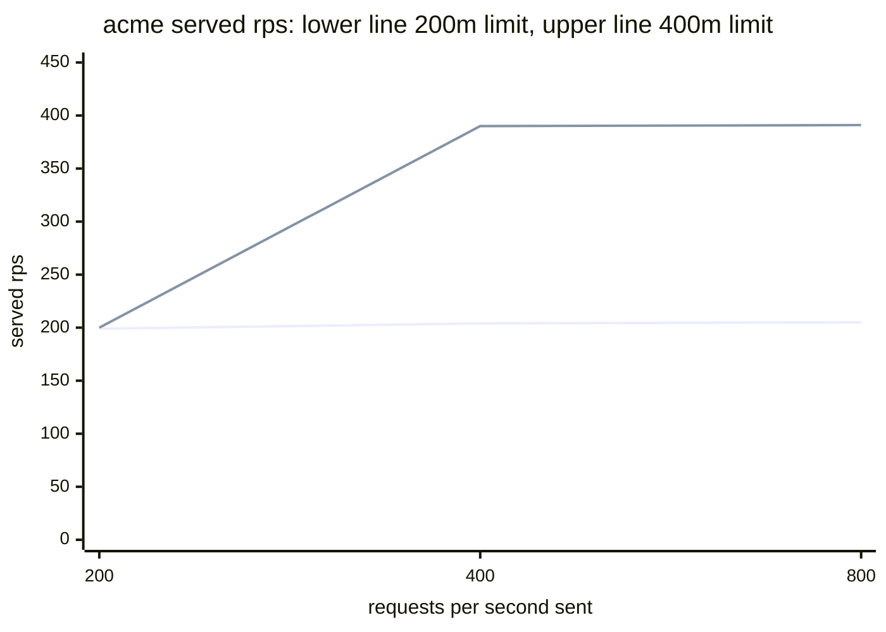

# Performance

**Result: acme's p95 fell from 539 ms to 6 ms at 200 requests per second after raising the small tier's CPU limit from 200m to 400m.**

## Method

`perf.yml` builds the platform on an Actions runner and runs `scripts/perf.sh`. For each tenant and each rate, k6 holds a constant arrival rate for 60 seconds against `/api/quote?items=100` through Traefik. Latency and errors come from k6's raw samples; the throttled share and the replica count come from Prometheus.

One variable changed between the two runs: `tiers.small.limits.cpuMillis`, 200 to 400, on the branch [`perf/small-cpu-400`](https://github.com/erdilatifi/BlastRadius/tree/perf/small-cpu-400). acme is on the small tier. globex is on the medium tier, which did not change, and is the control. Both tenants scale from 2 to 4 replicas.

| Result set | Run | Small tier CPU limit |
|---|---|---|
| [baseline.csv](performance/baseline.csv) | [43245594257](https://github.com/erdilatifi/BlastRadius/actions/runs/43245594257) | 200m, 10 to 160 rps |
| [high-baseline.csv](performance/high-baseline.csv) | [43250196674](https://github.com/erdilatifi/BlastRadius/actions/runs/43250196674) | 200m, 100 to 800 rps |
| [high-small-cpu-400.csv](performance/high-small-cpu-400.csv) | [43250204464](https://github.com/erdilatifi/BlastRadius/actions/runs/43250204464) | 400m, 100 to 800 rps |

## The bottleneck

Up to 160 rps nothing is throttled and, after the first warm-up step, p95 stays at 4 to 6 ms. At 200 rps the small tier is at its ceiling: 92% of CPU periods are throttled and p95 is 539 ms. Past that, acme never serves more than about 205 rps however much is sent.

The autoscaler cannot help. acme is already at its maximum of 4 replicas, so capacity is 4 pods times the limit. A quote for 100 items costs about 4 ms of CPU, which puts 4 pods at 200m near 200 rps.

## Before and after

acme, small tier:

| Rate | Limit | Served rps | p50 ms | p95 ms | p99 ms | Throttled | Replicas |
|---|---|---|---|---|---|---|---|
| 200 | 200m | 199 | 85 | 539 | 632 | 92% | 4 |
| 200 | 400m | 200 | 5 | 6 | 13 | 0% | 4 |
| 400 | 200m | 204 | 1993 | 2377 | 2439 | 92% | 4 |
| 400 | 400m | 390 | 607 | 1338 | 1482 | 99% | 4 |
| 800 | 200m | 205 | 2008 | 2442 | 2480 | 100% | 4 |
| 800 | 400m | 391 | 979 | 1603 | 1748 | 97% | 4 |

Doubling the limit doubled the ceiling, from about 205 to about 390 rps, and moved the knee from 200 rps to 400 rps.

globex, medium tier, unchanged between the runs:

| Rate | Run | Served rps | p95 ms | Throttled |
|---|---|---|---|---|
| 100 | baseline | 100 | 6 | 0% |
| 100 | experiment | 100 | 6 | 0% |
| 200 | baseline | 200 | 6 | 0% |
| 200 | experiment | 200 | 6 | 0% |
| 400 | baseline | 397 | 633 | 99% |
| 400 | experiment | 389 | 2001 | 98% |

## Limits of this result

- **Only the 200 rps row carries the claim.** Below the knee the control is steady at 6 ms in both runs. At saturation it is not: globex's p95 at 400 rps was 633 ms in one run and 2001 ms in the other with nothing changed. Queueing dominates there and single 60-second steps are noisy.
- **The first step of each run is not used.** acme at 100 rps shows errors in both result sets, 25% at 200m and 13% at 400m. It is the first load a fresh cluster sees and the tenant starts at 2 replicas. The cause was not isolated.
- **One run per configuration**, on shared Actions runners. Read the numbers as a clear direction, not a benchmark.

## Decision

The change stays on its branch. A CPU limit of 400m on a 50m request lets a small tenant burst to 8 times the request the capacity gate counts for it, which is the noisy-neighbour risk the tiers exist to bound. A tenant that needs 200 rps belongs on the medium tier: globex serves 200 rps at a p95 of 6 ms, and moving tier is one pull request.
